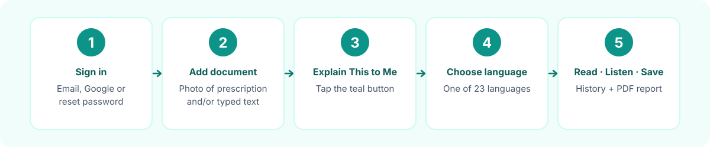
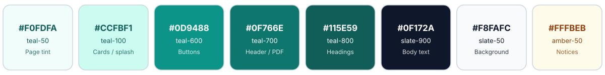

<div align="center">


<br>


**Upload a photo of a prescription. Get a plain-language explanation in your own language.**

</div>


## Contents

1. [What is Rxora?](#what-is-rxora)
2. [Built by and built at](#built-by-and-built-at)
3. [How it works at a glance](#how-it-works-at-a-glance)
4. [Step-by-step user guide](#step-by-step-user-guide)
   - [1. Sign in](#1-sign-in)
   - [2. Give Rxora your document (image or text)](#2-give-rxora-your-document-image-or-text)
   - [3. Start the explanation](#3-start-the-explanation)
   - [4. Select your language](#4-select-your-language)
   - [5. Read your results](#5-read-your-results)
   - [6. Listen to the explanation](#6-listen-to-the-explanation)
   - [7. Download the PDF report](#7-download-the-pdf-report)
   - [8. Open your history](#8-open-your-history)
   - [9. Accessibility settings](#9-accessibility-settings)
   - [10. Account menu](#10-account-menu)
5. [Supported languages](#supported-languages)
6. [What happens behind the scenes](#what-happens-behind-the-scenes)
7. [The PDF report in detail](#the-pdf-report-in-detail)
8. [Privacy and data](#privacy-and-data)
9. [Repository layout](#repository-layout)
10. [Run, test and deploy](#run-test-and-deploy)
11. [Troubleshooting](#troubleshooting)
12. [Known limitations](#known-limitations)
13. [Design system (colours)](#design-system-colours)
14. [Contact](#contact)
15. [License](#license)


## What is Rxora?

**Rxora** is an AI-powered web app that explains prescriptions and medical documents in simple, comforting language.
It is designed for elderly patients, people who are not comfortable reading medical English, and the family members who
look after them.

You give Rxora a photo of a prescription or medical report (or type the text in). Rxora reads it and produces:

| You get | What it contains |
|---|---|
| **Summary** | A short, plain-language explanation of what the document is about |
| **Key medical terms** | Hard words from the document, each with a simple meaning |
| **Critical warnings** | Short, distinct cautions such as "take with food" or "avoid alcohol" |
| **Medicine schedule** | A table of every medicine with its type, purpose and instructions, plus Morning, Afternoon and Night doses and duration |
| **Your action plan** | A checklist of things to do |
| **Diet and recovery plan** | Goal, foods to eat, foods to avoid, hydration guidance and daily tips |
| **Follow-up** | When or how to follow up with the doctor |
| **Important notes** | Dates and dosage reminders worth remembering |

Everything is available in **23 languages**, can be **read aloud** (English), is **saved to your history**, and can be
**downloaded as a clean multi-page PDF**.

> **Please note:** Rxora is an AI tool that helps you understand medical documents. It does not replace a doctor or give
> medical advice. Always rely on your healthcare professional for treatment decisions, and keep the original document
> for your doctor's reference.


## Built by and built at

**Rxora was created by Polanki Thrinath**, who is currently pursuing studies in **Artificial Intelligence & Machine
Learning** at **Vasireddy Venkatadri International Technological University (VVITU)**, Namburu, Guntur, Andhra Pradesh,
India.

It was built at **PromptWars X Creative Community VVITU**.

### About the event

- **PromptWars** is a vibe-coding hackathon format by **Google for Developers** and **Hack2skill**. Instead of writing
  every line by hand, participants describe what they want in prompts and use AI tools (such as Google Antigravity or
  Google AI Studio) to build a working solution in limited time.
- **PromptWars X Community** is the licensed community edition of that programme. A campus club, developer community or
  organiser runs it under its own name, online or offline, with the programme's platform, branding and support. The
  VVITU edition is therefore named **PromptWars X Creative Community VVITU**.
- The focus is on **intent-driven development**: clear thinking, creativity and good prompting, turned into a real,
  working app.
- Rxora is one such app. It takes the very practical problem of hard-to-read prescriptions and uses AI to turn it into
  something a patient can actually understand.

> This repository documents the Rxora project. For the dates, schedule, venue and results of the VVITU edition, please
> refer to the event organisers; they are intentionally not stated here.


## How it works at a glance



```text
Sign in  ─►  Add photo and/or text  ─►  "Explain This to Me"  ─►  Pick a language
                                                                        │
              ┌─────────────────────────────────────────────────────────┘
              ▼
   AI reads the document  ─►  Results screen  ─┬─►  Read aloud (English)
   (saved to your history)                     ├─►  Download PDF report
                                               └─►  "Analyze Another"
```


## Step-by-step user guide

### 1. Sign in

Rxora opens with a short splash screen and then a sign-in screen. You can:

- **Sign up** with your first name, last name, email address and a password (minimum 8 characters), or
- **Log in** with an existing email and password, or
- tap **Continue with Google**, or
- tap **Forgot Password?**, enter your email and receive a reset link (use **Back to Sign In** to return).

The first time you use the app, a short **onboarding guide** explains the three main steps (upload, choose a language,
read the explanation). You can reopen it any time from the account menu under **Help Guide**.

### 2. Give Rxora your document (image or text)

You can use **either option, or both together**.

**Option A: Upload an image**

1. Tap or click the dashed box that says **"Click to upload photo or drag and drop here"**, or drag a picture onto it.
2. Choose an image from your device. On a phone this lets you pick a photo from your gallery or take a new one.
3. A preview appears. If it is the wrong picture, tap the red **✕** on the preview to remove it and choose another.

**Option B: Type or paste text**

Type or paste the prescription or report text into the text box under **"Let's check your document"**. This is useful
if you already have the text, or if a photo is hard to read.

#### How to take a good prescription photo

A clear photo gives a much better explanation.

| Do | Avoid |
|---|---|
| Place the paper on a flat, plain surface | Holding the paper at an angle or in the air |
| Use good, even light (daylight is best) | Shadows across the text, glare and flash reflections |
| Keep the **whole** prescription in the frame, including the doctor's notes and the medicine table | Cropping out edges or part of the table |
| Hold the phone directly above the paper so the lines look straight | Tilted, curved or skewed shots |
| Wait for the camera to focus | Blurry, shaky photos |
| Upload one document at a time | Putting several different documents in one picture |

Notes:

- Only **image files** are accepted (for example JPG or PNG). PDFs and other file types are not accepted; if you have
  a PDF, take a screenshot or type the text instead.
- If you add neither text nor an image, Rxora shows: *"Please add text or upload an image to start."*
- If a person cannot read the handwriting, the AI may not either. Type the medicine names into the text box as well.

### 3. Start the explanation

Tap the large teal button **Explain This to Me**.

### 4. Select your language

A **Select Output Language** window opens. Choose the language you want the explanation in by tapping its name.
**English** is first, followed by Hindi, Telugu, Tamil and the other languages listed [below](#supported-languages).

- Tap **Cancel Selection** at the bottom of the window to go back without analysing.
- As soon as you pick a language, the main button changes to **Reading Document...** with a spinner while the AI
  works. Please wait; this normally takes a few seconds.

To get the same document in a different language, tap **Analyze Another**, add the document again and choose a new
language. You can also reopen an earlier result from [History](#8-open-your-history).

### 5. Read your results

The screen **"Here is what we found"** shows the explanation in your chosen language, in clearly separated cards:
summary, key medical terms, critical warnings, medicine schedule (Morning, Afternoon, Night, duration), action
checklist, follow-up and important notes. Medical terms are shown with their simple meaning so you can still recognise
them when talking to your doctor.

The **Diet & Recovery Plan** appears as a green card. Tap it to open a pop-up with the goal, foods to eat, foods to
avoid, hydration advice and daily tips; tap **Close** to return.

At the bottom of the results you will find:

| Control | What it does |
|---|---|
| **Download** icon | Opens the Patient Details form for the PDF (see [step 7](#7-download-the-pdf-report)) |
| **Analyze Another** | Clears the screen and returns to the upload page |

### 6. Listen to the explanation

Tap the round **speaker** button next to the heading **"Here is what we found"** to have the summary read aloud.
Tap it again to stop.

- Read-aloud is available when the report language is **English**; the speaker button is hidden for other languages.
- Turn on **Slow Speech** in the accessibility menu for a slower reading pace.

### 7. Download the PDF report

1. On the results screen, tap the **Download as PDF** icon.
2. A **Patient Details** form appears. These details are printed on the PDF only.
   - **Patient name**: required, up to 100 characters.
   - **Age**: required, a whole number from 0 to 120.
   - Optionally tick **Use the account details** to fill in the name from your account.
3. Tap **Generate PDF**. The button shows **Generating PDF...** while the file is built (usually a second or two).
4. Your browser downloads `Rxora-<Patient-Name>-Medical-Summary.pdf`.

If something goes wrong, the form stays open with a clear message and your results are kept, so you can try again.
Press **Esc** or **Cancel** to close the form.

### 8. Open your history

Every successful analysis made while you are signed in is saved to your account automatically.

1. Tap the **clock (History)** icon in the top bar.
2. **Your History** opens, with your most recent reports first (up to the latest 20). Each entry shows the date, the
   language and the first lines of the summary.
3. Tap an entry to reopen that full report instantly, with no new AI call. From there you can read it, listen to it
   (English) and download its PDF.
4. Tap **Close** to leave History.

History is private to your account.

### 9. Accessibility settings

Tap the **accessibility** icon in the top bar. Your choices are remembered on your device.

| Setting | Effect |
|---|---|
| **Larger Text** | Increases text size across the app |
| **High Contrast** | Black background with white text and yellow highlights for easier reading |
| **Slow Speech** | Reads aloud at a slower pace |

### 10. Account menu

Tap your avatar and name in the top bar for:

- **Help Guide**: reopens the short how-to-use walkthrough.
- **Change Password**: enter your current password and a new one (minimum 8 characters).
- **Log Out**.

At the bottom of every page, **Contact Us** opens an email to [polankithrinath@gmail.com](mailto:polankithrinath@gmail.com).


## Supported languages

Pick any of these on the language screen. The AI writes all values (summary, meanings, warnings, instructions, diet
tips) in the chosen language.

| | | | | |
|---|---|---|---|---|
| English | Hindi | Telugu | Tamil | Kannada |
| Malayalam | Marathi | Gujarati | Bengali | Punjabi |
| Urdu | Odia | Assamese | Maithili | Santali |
| Kashmiri | Nepali | Konkani | Sindhi | Dogri |
| Manipuri | Bodo | Sanskrit | | |

Section headings on the results screen are in English; the content under them is in your language.


## What happens behind the scenes

1. **Your input.** The text you typed and/or the image you chose is read in your browser. An image is converted to
   base64 and, when you are signed in, a copy is stored in your private Firebase Storage folder.
2. **The request.** When you choose a language, the app sends the text, the image and the language to an AI service
   (Gemini) through a **Google Apps Script** proxy, which keeps the AI credentials off the web page. If a request
   fails, the app retries up to 3 times.
3. **The instruction to the AI.** The app asks the AI to act as an empathetic health assistant for elderly patients,
   non-native speakers and caregivers; to simplify medical language; and to return a fixed JSON structure (`summary`,
   `medicines`, `dosage_table`, `critical_warnings`, `diet_plan`, `follow_up`, `terms`, `checklist`, `notes`). Diet
   advice follows common Indian food habits and is safe and non-prescriptive.
4. **Showing the result.** The JSON is rendered into the cards you see on the results screen.
5. **Saving.** The result is saved to your history in Cloud Firestore under your own user ID.
6. **The PDF.** When you download, the exact result already on screen is sent to a small Python function
   (`/api/generate-pdf`) that typesets the PDF. There is no screenshot and no second AI call.

```text
Browser (index.html)                                         Vercel
 Download ─► patient details form ─► POST /api/generate-pdf ──► api/generate-pdf.py
                                       { patient, language,        │ validate request
                                         date, result }            │ build PDF with ReportLab
 save file  ◄──────── 200 application/pdf  ◄───────────────────────┘
```


## The PDF report in detail

The PDF is a clean, A4, multi-page document in Rxora's teal style.

- **Header:** the Rxora logo, name and tagline *Making Medical Terms Simple*, followed by a teal rule.
- **Patient block:** patient name, age, report date and language. On pages 2 and onwards a slim "Patient: ..." strip
  repeats under the header so a loose page can always be identified.
- **Sections:** Summary, Key Medical Terms, Critical Warnings, Medicine Schedule, Your Action Plan, Important Notes,
  Follow Up, and Diet & Recovery Plan.
- **Footer on every page:** `Rxora` on the left, `Page X of Y` in the centre, and the contact email
  `polankithrinath@gmail.com` on the right (a clickable `mailto:` link).
- **Disclaimer:** the standard "Please Note" safety text appears at the end of the report.
- **Scripts and fonts:** Noto fonts are bundled for Latin, Devanagari, Bengali, Gujarati, Gurmukhi, Kannada, Malayalam,
  Odia, Tamil, Telugu, Arabic/Urdu, Ol Chiki and Meitei Mayek, with proper text shaping so Indian-language text
  displays correctly.
- **Nothing is cut off:** long prescriptions flow onto additional pages and table text wraps.
- **Searchable:** text in the PDF can be searched and copied.
- **Filename:** `Rxora-<Patient-Name>-Medical-Summary.pdf`. Names in Indian scripts are supported.
- **Document properties:** the title is `Rxora Medical Summary - <name>` and the author is `Rxora`.


## Privacy and data

- Rxora is an informational tool and does not provide a diagnosis or treatment.
- When you are signed in, your reports are stored in Cloud Firestore under your own account, and uploaded images in
  Firebase Storage under your own user folder.
- The typed original text is saved to history only as a short preview (first 100 characters).
- Accessibility choices and the "onboarding seen" flag are stored in your browser's local storage on your device.
- The PDF function only receives what is needed to build the file, never logs request bodies, and returns safe generic
  errors without technical details.
- Include only the personal information you need, and share PDFs only with people you trust.


## Repository layout

```text
Rxora/
├── index.html                  The entire front end (single page: Tailwind CSS, Lucide icons, Firebase, AI via Apps Script)
├── Rxora Logo.png              Logo and favicon used by index.html (keep at the repo root)
├── api/
│   └── generate-pdf.py         Vercel Python function: POST /api/generate-pdf  ->  application/pdf
├── rxora_pdf/                  PDF engine (ReportLab), imported by the API function
│   ├── generator.py            create_rxora_pdf(), input normalisation, safe filename
│   ├── request.py              server-side validation of the API request
│   ├── template.py             header, footer and page numbering
│   ├── sections.py             summary, terms, warnings, medicine table, action plan, notes, follow-up, diet
│   ├── styles.py  theme.py     typography, colours and brand text (edit here to restyle)
│   ├── fonts.py                Unicode fonts, per-word script switching, HarfBuzz shaping
│   ├── assets/                 rxora_logo.png (used in the PDF header)
│   └── fonts/                  Noto fonts for 12 Indic/Arabic scripts + Latin (required at runtime)
├── examples/
│   ├── input/                  Sample request data (English, Hindi, Telugu, Urdu, flat schema)
│   └── pdfs/                   Sample generated PDF
├── tests/
│   ├── python/test_generate.py PDF engine and validation tests
│   └── frontend/               jsdom tests for the download-form flow
├── tools/patch_fonts.py        One-off script that prepared the fonts (already applied)
├── docs/
│   ├── assets/                 README images (banner, workflow, palette, divider)
│   ├── INTEGRATION.md          Architecture, API contract, manual test checklist
│   ├── PDF_MODULE.md           PDF engine reference
│   ├── index.html.patch        Diff of the PDF-export change
│   └── ORIGINAL_README.md      Earlier README, kept for reference
├── vercel.json                 Bundles rxora_pdf/** into the Python function
├── requirements.txt            reportlab, uharfbuzz, Pillow
└── LICENSE
```

## Run, test and deploy

**Run the site locally (including the PDF function)**

```bash
npm i -g vercel
vercel dev          # serves index.html and /api/generate-pdf together
```

A plain static server (for example `python -m http.server`) shows the page but has no `/api`, so PDF download will
say the PDF service was not found.

**Make a PDF from sample data (command line)**

```bash
pip install -r requirements.txt
python -m rxora_pdf examples/input/sample_input.json --out out/
```

**Run the tests**

```bash
pip install pytest pypdf
python -m pytest tests/python -q                # PDF engine and validation tests

cd tests/frontend
npm install
python server.py &                              # local PDF server on port 8777
npm test                                        # download-form flow tests (jsdom)
```

**Deploy**

Push the repository to Vercel with the repo root as the project root. `index.html` is served statically and
`api/generate-pdf.py` runs as a Python function. No environment variables or secrets are needed for the PDF export.

## Troubleshooting

| Problem | What to do |
|---|---|
| "Please add text or upload an image to start." | Type text or choose an image first |
| "Please upload an image file (JPG, PNG)." | The chosen file is not an image. Use a photo or screenshot |
| The explanation looks wrong or incomplete | Retake the photo in better light with the whole page in frame, or paste the text |
| The speaker button is missing | Read-aloud is shown for English reports only |
| History is empty | You must be signed in; only analyses made while signed in are saved |
| PDF shows "Could not generate the PDF" | Read the second line in the form. Quick check: open `/api/generate-pdf` in the browser; it should return JSON containing `"status": "ok"` |
| "PDF service was not found on this page" | You are on a static server. Use the deployed site or run `vercel dev` |

## Known limitations

- The explanation is generated by AI and can contain mistakes. Always confirm with a doctor or pharmacist.
- Read-aloud is English only.
- In PDFs, right-to-left text (such as Urdu) is shaped and aligned correctly, but tables are not mirrored.
- Only Telugu, Hindi, Urdu and English PDFs were visually reviewed; other scripts were checked for glyph coverage and
  should be reviewed by a native reader before relying on them.
- Static headings and labels are in English.
- Vercel deployment settings (function size and cold start) should be checked on your plan.


## Design system (colours)

The README, the app and the PDF share one teal-and-slate palette, so everything looks like one product.



| Role | Colour | Used for |
|---|---|---|
| Primary | `#0F766E` (teal-700) | App header, PDF header, section accents |
| Action | `#0D9488` (teal-600) | Buttons and links |
| Deep | `#115E59` (teal-800) | Headings and the brand name |
| Soft | `#CCFBF1` / `#F0FDFA` | Splash screen, cards, highlights |
| Text | `#0F172A` (slate-900) | Body text |
| Background | `#F8FAFC` (slate-50) | Page background |
| Notice | `#FFFBEB` / `#FBBF24` (amber) | "Please Note" disclaimer |
| Danger | `#B91C1C` / `#FEF2F2` (red) | Critical warnings and errors |

Typeface: **Inter** in the app; **Noto Sans** in the PDF.

## Contact

Questions, feedback or support: **[polankithrinath@gmail.com](mailto:polankithrinath@gmail.com)**

Rxora was created by **Polanki Thrinath**, Artificial Intelligence & Machine Learning, Vasireddy Venkatadri
International Technological University (VVITU), at **PromptWars X Creative Community VVITU**.

## License

See [LICENSE](LICENSE). Bundled Noto fonts are licensed under the SIL Open Font License.
